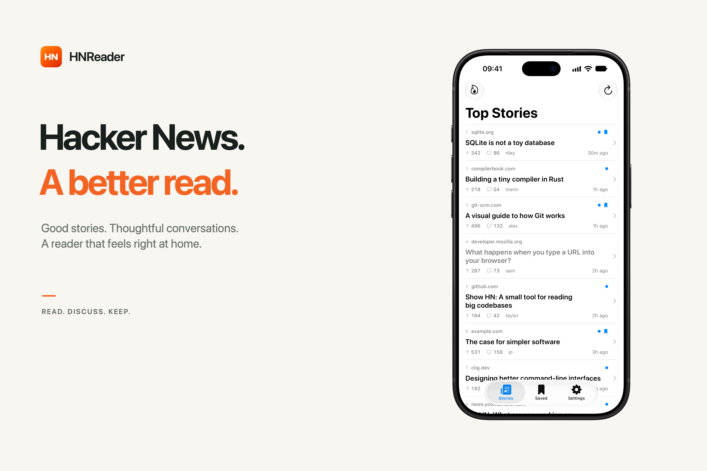
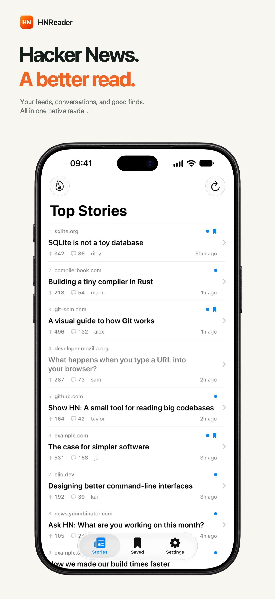
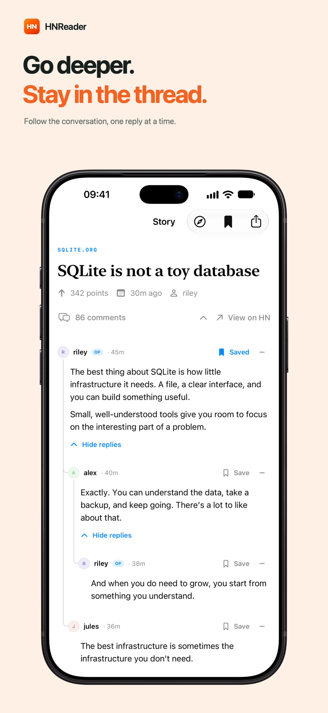
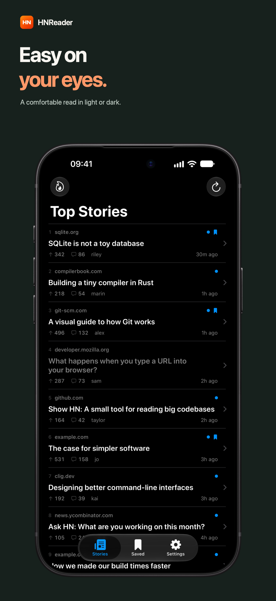
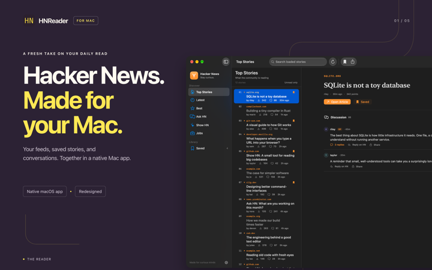

<p align="center">
    
</p>

# HNReaderApp
This is the public repository for HNReader, a native Hacker News reader for iOS and macOS.

You can report any issue and suggest/request new features in the [issue](https://github.com/mattrighetti/HNReaderApp/issues) section, you can also use the [discussions](https://github.com/mattrighetti/HNReaderApp/discussions) section to chat with others and me about the application.

The application is still in beta for the moment and needs optimizations. When the time come I will release it to AppStore and on `brew`.

<p align="center">
<a href="https://apps.apple.com/it/app/hnews-reader/id1572480416?l=en&mt=12">

</a>
</p>

## iOS reader

<p align="center">

</p>

The iOS app targets iOS 18 or later and supports iPhone and iPad. Run the
`HNReader iOS` scheme on an iOS device or simulator.

- Browse feeds with search, unread filtering, pull-to-refresh, and automatic pagination.
- Read discussions, expand replies, and open author profiles and their comments.
- Save stories and comments for later, including an offline snapshot of saved comments.
- Choose an orange, plum, midnight, or forest app icon in Settings.

To open Hacker News links from the iOS share sheet, create a shortcut with
HNReader’s **Open in HNReader** action. Turn on **Show in Share Sheet** in the
shortcut’s details, set it to receive **URLs**, and pass **Shortcut Input** to
the action’s **Hacker News URL** field. Choose that shortcut when sharing a
Hacker News story or comment link to open its discussion in HNReader.

Both apps are version 2.1.0. Views own their presentation and loading state;
shared services return complete pages, while `HNClient/FeedRepository.swift`
retains the feed cache. Saved items and read status live in the shared `AppState` store.

### App preview

<p align="center">
    
    
    
</p>

## Modern macOS reader

The app targets macOS 26.6 or later and uses a native three-column SwiftUI interface:

- Top, Latest, Best, Ask HN, Show HN, and Jobs feeds.
- In-app discussions with curved thread connectors, collapsible comments, author avatars,
  original-poster badges, selectable text, sharing, and replies loaded on demand.
  Floating up/down controls jump between top-level threads, skipping nested replies.
- Saved stories and read status persisted locally across launches.
- Search by title, author, or domain within the loaded feed or saved stories.
- Unread filtering, automatic pagination, and loading/error/retry states.
- Native sharing, article links, and appearance that follows macOS.

Open `HNReader.xcodeproj` in Xcode and run the `HNReader` scheme.
Use **⌘R** to refresh a feed and **⌘D** to save or unsave the selected story.
Articles open in your default browser. Saved story metadata is available offline;
discussions require a connection. Bookmarks and read status are stored on this Mac.

### macOS marketing preview

<p align="center">
    
</p>

Feed data comes from the official Hacker News Firebase REST API. The app loads
30 stories per page, with at most eight item requests in flight. A page appears
only when every request has finished, preserving ranking without individual row
insertions. Scrolling to the bottom automatically requests the next 30 stories.
Failed pages leave the existing list intact and can be retried.

Visited sections retain their loaded pages for one minute. A shared `NSCache` in
`HNClient/ItemCache.swift` reuses story and comment metadata for two minutes and
allows eviction under memory pressure. Networking lives in `HNClient/NewsService.swift`.
**⌘R** requests fresh IDs and first-page metadata.

## Previews

Every visible screen and component has named SwiftUI Canvas previews. Open a view
file and enable **Editor → Canvas** to switch between light/dark and relevant
loading, empty, and error states. Shared fixtures live in
`HNReader/Preview Content/PreviewData.swift`; previews do not fetch live data or
use the app’s saved preferences.

See the [Canvas preview index](resources/previews/README.md) for the available
screens and states.

To run the deterministic tests without live API requests:

```sh
xcodebuild -project HNReader.xcodeproj -scheme HNReader \
  -destination 'platform=macOS' CODE_SIGNING_ALLOWED=NO test
```

## License
[MIT](LICENSE) or [APACHE 2.0](LICENSE)
